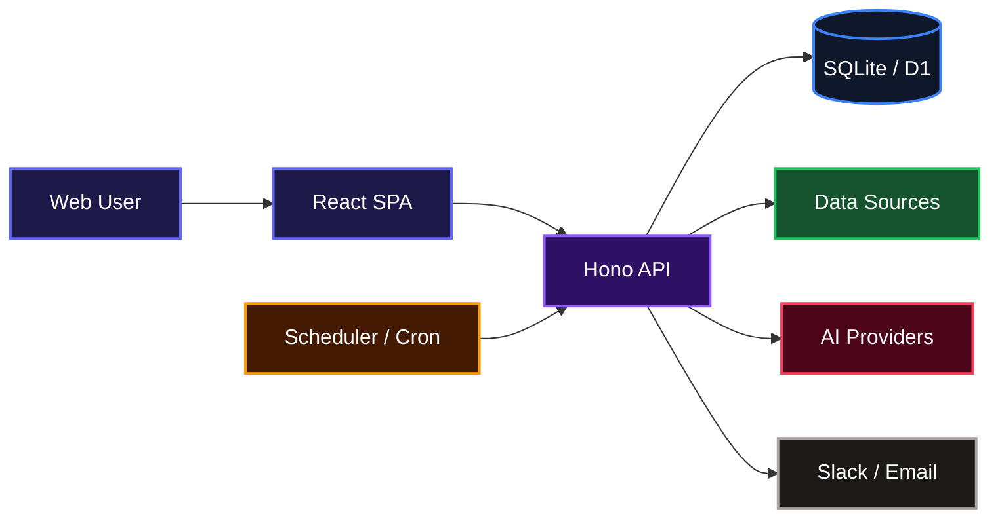
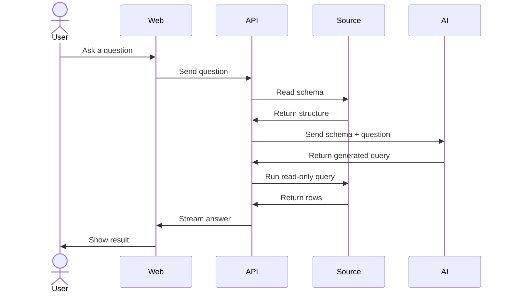
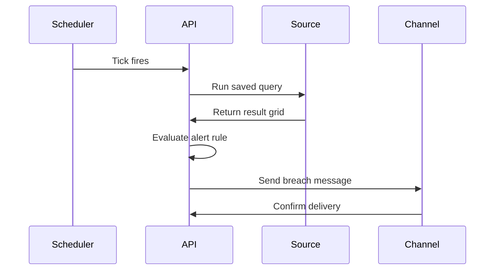

# Heptadec

Query, visualize, and monitor all the data systems your team already runs, from one place.

Heptadec gives teams a single workspace to connect their databases, document stores, caches, and search engines, then explore them with a schema browser, SQL/command runner, AI-assisted queries, dashboards, scheduled jobs, threshold alerts, and share links. It turns scattered data sources into a consistent, team-friendly interface without requiring a dedicated data engineering effort.



## Features

- **Connect many engines in one place**: PostgreSQL, MySQL, MariaDB, ClickHouse, SQLite, LibSQL/Turso, MongoDB, Redis, and Quickwit.
- **AI-assisted querying**: Ask a question in plain English and get a ready-to-run statement, aggregation pipeline, Redis command, or search query.
- **Schema browser**: Inspect tables, columns, indexes, and relationships for SQL engines and MongoDB.
- **Dashboards with charts**: Build bar, line, and pie charts over saved queries, and let AI generate whole dashboards from your sources.
- **Scheduled queries and alerts**: Run saved queries on a cron schedule and send notifications when a column crosses a threshold.
- **Share links**: Publish read-only dashboard snapshots that anyone with the link can view.
- **Read-only MCP endpoint**: Let external agents list sources, describe schemas, and run safe read-only queries through a scoped token.
- **Organizations and roles**: Multi-tenant workspaces with owner, editor, and viewer roles.

### AI-Assisted Query Flow



### Scheduled Alert Flow



## Technologies Used

| Layer | Technology |
|---|---|
| API | TypeScript, Hono, Drizzle ORM |
| Web | React, Vite, Tailwind CSS |
| Auth | Better Auth |
| App database | SQLite (local), D1 (Cloudflare Workers) |
| File storage | Cloudflare R2 |
| Background jobs | In-process scheduler (Node), Cron Trigger (Workers) |
| Testing | Vitest against real engines and databases |
| Deployment | Docker, Cloudflare Workers |

## Getting Started

Requirements: Node.js 22+, pnpm 12+, and optionally Docker for demo databases.

Clone the repository:

```bash
git clone git@github.com:Mbazu-Daniel/Heptadec.git
cd Heptadec
pnpm install
```

Generate the two required secrets and put them in `.env`:

```bash
openssl rand -base64 32   # BETTER_AUTH_SECRET
openssl rand -base64 32   # HEPTADEC_SECRET_KEY — keep this one; it encrypts stored credentials
```

Create the app database and start both servers:

```bash
pnpm db:migrate
pnpm dev
```

The API listens on `http://localhost:8787` and the web app on `http://localhost:5173`.

To try queries against seeded demo engines:

```bash
pnpm compose:up    # Postgres, MySQL, Redis
pnpm compose:down  # when finished
```

### Useful Commands

| Purpose | Command |
|---|---|
| Dev servers | `pnpm dev` |
| Typecheck everything | `pnpm typecheck` |
| Integration tests | `pnpm test` |
| Billing tests | `pnpm test:billing` |
| Start the full test stack | `pnpm compose:test:up` |
| Seed the test stack | `pnpm seed:test` |
| Generate / apply app migrations | `pnpm db:generate` / `pnpm db:migrate` |
| Deploy to Cloudflare Workers | `pnpm deploy:cloudflare` |

## Usage

### Ask a natural-language question

After connecting a data source and adding an AI provider, send a question:

```bash
curl -X POST http://localhost:8787/api/ai/ask \
  -H "Content-Type: application/json" \
  -H "Cookie: ..." \
  -d '{"question": "Show total revenue by region"}'
```

The response is a server-sent event stream. Final payload:

```json
{
  "chatId": "0194...",
  "dataSourceId": "...",
  "dataSourceName": "Production Postgres",
  "language": "sql",
  "sql": "SELECT r.name, SUM(oi.quantity * oi.unit_price) AS total FROM ...",
  "answered": true,
  "providerName": "OpenAI",
  "model": "gpt-4o",
  "durationMs": 3421
}
```

### Run a query directly

```bash
curl -X POST http://localhost:8787/api/data-sources/{id}/query \
  -H "Content-Type: application/json" \
  -H "Cookie: ..." \
  -d '{"sql": "SELECT * FROM orders LIMIT 10"}'
```

### Create a scheduled job

```bash
curl -X POST http://localhost:8787/api/scheduled-jobs \
  -H "Content-Type: application/json" \
  -H "Cookie: ..." \
  -d '{
    "savedQueryId": "...",
    "name": "Hourly revenue check",
    "cron": "0 * * * *",
    "timezone": "UTC"
  }'
```

### Generate a dashboard with AI

```bash
curl -X POST http://localhost:8787/api/dashboards/generate \
  -H "Content-Type: application/json" \
  -H "Cookie: ..." \
  -d '{
    "name": "Revenue Dashboard",
    "dataSourceIds": ["..."],
    "brief": "Show revenue and order trends"
  }'
```

## API Reference

Authentication is session-based through Better Auth. Most endpoints require a valid session cookie and membership in the active organization.

### AI

#### `GET /api/ai/providers`
List configured AI providers and the global provider catalog.

**Request**: none

**Response**:
```json
{
  "providers": [...],
  "catalog": [...]
}
```

**Errors**:
- `401`: Authentication required

#### `POST /api/ai/providers`
Create a new AI provider.

**Request**:
```json
{
  "name": "OpenAI",
  "provider": "openai",
  "model": "gpt-4o",
  "apiKey": "sk-...",
  "isDefault": true
}
```

**Response**:
```json
{
  "id": "...",
  "name": "OpenAI",
  "provider": "openai",
  "providerLabel": "OpenAI",
  "model": "gpt-4o",
  "baseUrl": null,
  "isDefault": true,
  "createdAt": "2025-01-01T00:00:00.000Z"
}
```

**Errors**:
- `400`: Invalid provider or missing fields
- `401`: Authentication required
- `403`: Only owners can manage AI providers

#### `DELETE /api/ai/providers/:id`
Delete an AI provider.

**Request**: none

**Response**:
```json
{
  "removed": "..."
}
```

**Errors**:
- `401`: Authentication required
- `403`: Only owners can manage AI providers
- `404`: Provider not found

#### `GET /api/ai/providers/:id/models`
List available models for a configured provider.

**Request**: none

**Response**:
```json
{
  "source": "provider",
  "models": [{ "id": "gpt-4o", "label": null }]
}
```

**Errors**:
- `401`: Authentication required
- `403`: Only owners can manage AI providers
- `404`: Provider not found

#### `POST /api/ai/providers/models`
List models from a provider using a one-off API key.

**Request**:
```json
{
  "provider": "openai",
  "apiKey": "sk-...",
  "baseUrl": "https://api.openai.com/v1"
}
```

**Response**:
```json
{
  "source": "provider",
  "models": [...]
}
```

**Errors**:
- `400`: Invalid provider or key
- `401`: Authentication required
- `403`: Only owners can manage AI providers

#### `POST /api/ai/ask`
Ask a natural-language question and receive a generated query as a server-sent event stream.

**Request**:
```json
{
  "question": "Top 10 products by revenue",
  "dataSourceIds": ["..."],
  "providerId": "..."
}
```

**Response**: SSE stream ending with:
```json
{
  "chatId": "...",
  "dataSourceId": "...",
  "dataSourceName": "...",
  "language": "sql",
  "sql": "...",
  "pipeline": null,
  "command": null,
  "search": null,
  "answered": true,
  "providerName": "...",
  "model": "...",
  "durationMs": 1234
}
```

**Errors**:
- `400`: Missing question or no askable source
- `401`: Authentication required
- `403`: Only owners and editors can ask questions

### Alerts

#### `GET /api/alert-rules`
List alert rules.

**Request**: none

**Response**:
```json
{
  "alertRules": [
    {
      "id": "...",
      "savedQueryId": "...",
      "name": "Revenue threshold",
      "column": "total",
      "operator": ">",
      "threshold": 1000,
      "scheduled": true,
      "createdAt": "...",
      "updatedAt": "..."
    }
  ]
}
```

**Errors**:
- `401`: Authentication required

#### `POST /api/alert-rules`
Create an alert rule.

**Request**:
```json
{
  "savedQueryId": "...",
  "name": "Revenue threshold",
  "column": "total",
  "operator": ">",
  "threshold": 1000
}
```

**Response**:
```json
{
  "alertRule": { ... }
}
```

**Errors**:
- `400`: Invalid operator or missing fields
- `401`: Authentication required
- `403`: Only owners and editors can add alert rules
- `404`: Saved query not found

#### `PUT /api/alert-rules/:id`
Update an alert rule.

**Request**:
```json
{
  "name": "Revenue threshold",
  "column": "total",
  "operator": ">",
  "threshold": 2000
}
```

**Response**:
```json
{
  "alertRule": { ... }
}
```

**Errors**:
- `400`: Invalid operator or missing fields
- `401`: Authentication required
- `403`: Only owners and editors can change alert rules
- `404`: Alert rule not found

#### `DELETE /api/alert-rules/:id`
Delete an alert rule.

**Request**: none

**Response**:
```json
{
  "id": "..."
}
```

**Errors**:
- `401`: Authentication required
- `403`: Only owners and editors can remove alert rules
- `404`: Alert rule not found

#### `GET /api/alert-deliveries`
List recent alert deliveries.

**Request**: none

**Response**:
```json
{
  "alertDeliveries": [...]
}
```

**Errors**:
- `401`: Authentication required

#### `POST /api/saved-queries/:id/alert-checks`
Check alerts for a saved query on demand.

**Request**: none

**Response**:
```json
{
  "alertDeliveries": [...]
}
```

**Errors**:
- `401`: Authentication required
- `403`: Only owners and editors can check a query's alerts
- `404`: Saved query not found

### Audit

#### `GET /api/audit-logs`
List audit log entries, with optional filters.

**Query parameters**: `event`, `target`, `since`, `until`, `q`

**Request**: none

**Response**:
```json
{
  "auditLogs": [...]
}
```

**Errors**:
- `401`: Authentication required
- `403`: Only owners can see the audit log

### Auth

#### `ALL /api/auth/*`
Better Auth endpoints for sign up, sign in, sign out, password reset, and OAuth callbacks.

**Request / Response**: See the Better Auth documentation for route details.

#### `GET /api/providers`
List enabled OAuth providers.

**Request**: none

**Response**:
```json
{
  "providers": [
    { "id": "google", "label": "Sign in with Google" }
  ]
}
```

#### `GET /api/me`
Return the current user and their active organization membership.

**Request**: none

**Response**:
```json
{
  "user": {
    "id": "...",
    "name": "...",
    "email": "...",
    "image": null,
    "hasPassword": true,
    "onboardingCompleted": true
  },
  "displayName": null,
  "image": null
}
```

**Errors**:
- `401`: Authentication required

#### `POST /api/onboarding/complete`
Mark onboarding as complete.

**Request**: none

**Response**:
```json
{
  "user": { "id": "...", "onboardingCompleted": true }
}
```

**Errors**:
- `401`: Authentication required

### Billing

#### `GET /api/billing`
Get the current billing summary.

**Request**: none

**Response**:
```json
{
  "configured": true,
  "entitled": true,
  "accountPaid": false,
  "paidUntil": null,
  "cadence": null,
  "autoRenew": false,
  "hasCard": false,
  "cardLast4": null,
  "organizationsOwned": 1,
  "freeOrgLimit": 1,
  "plans": [...]
}
```

**Errors**:
- `401`: Authentication required

#### `POST /api/billing/checkout`
Start a paid checkout session.

**Request**:
```json
{
  "cadence": "monthly"
}
```

**Response**:
```json
{
  "checkoutUrl": "https://..."
}
```

**Errors**:
- `400`: Billing not configured or invalid cadence
- `401`: Authentication required
- `403`: Only owners can start a billing checkout

#### `POST /api/billing/auto-renew`
Enable or disable automatic renewal.

**Request**:
```json
{
  "enabled": true
}
```

**Response**:
```json
{
  "autoRenew": true
}
```

**Errors**:
- `400`: No saved card or invalid request
- `401`: Authentication required
- `403`: Only owners can change auto-renew

#### `POST /api/webhooks/bachs`
Bachs webhook for checkout and subscription events.

**Request**: raw signed JSON body

**Response**:
```json
{
  "received": true
}
```

**Errors**:
- `400`: Invalid signature or payload
- `500`: Billing webhooks not configured

### Dashboards

#### `GET /api/dashboards`
List dashboards.

**Request**: none

**Response**:
```json
{
  "dashboards": [...]
}
```

**Errors**:
- `401`: Authentication required

#### `POST /api/dashboards`
Create a dashboard.

**Request**:
```json
{
  "name": "Revenue Dashboard",
  "dataSourceIds": ["..."]
}
```

**Response**:
```json
{
  "dashboard": { ... }
}
```

**Errors**:
- `400`: Missing name or sources
- `401`: Authentication required
- `403`: Only owners and editors can create dashboards

#### `GET /api/dashboards/:id`
Get a single dashboard with its widgets and sources.

**Request**: none

**Response**:
```json
{
  "dashboard": { ... }
}
```

**Errors**:
- `401`: Authentication required
- `404`: Dashboard not found

#### `PATCH /api/dashboards/:id`
Rename a dashboard or change its connected sources.

**Request**:
```json
{
  "name": "Updated Name",
  "dataSourceIds": ["..."]
}
```

**Response**:
```json
{
  "dashboard": { ... }
}
```

**Errors**:
- `400`: No changes provided
- `401`: Authentication required
- `403`: Only owners and editors can rename dashboards
- `404`: Dashboard not found

#### `DELETE /api/dashboards/:id`
Delete a dashboard.

**Request**: none

**Response**:
```json
{
  "id": "..."
}
```

**Errors**:
- `401`: Authentication required
- `403`: Only owners and editors can delete dashboards
- `404`: Dashboard not found

#### `POST /api/dashboards/:id/widgets`
Add a widget to a dashboard.

**Request**:
```json
{
  "savedQueryId": "...",
  "chartType": "bar",
  "title": "Revenue by region",
  "labelColumn": "region",
  "valueColumn": "total"
}
```

**Response**:
```json
{
  "widget": { ... }
}
```

**Errors**:
- `400`: Invalid chart type or missing fields
- `401`: Authentication required
- `403`: Only owners and editors can add charts
- `404`: Dashboard or saved query not found

#### `GET /api/widgets/:id/data`
Get chart data.

**Request**: none

**Response**:
```json
{
  "points": [...],
  "rowCount": 10,
  "truncated": false,
  "durationMs": 12,
  "ranAt": "...",
  "stale": false
}
```

**Errors**:
- `401`: Authentication required
- `404`: Widget not found

#### `POST /api/widgets/:id/refresh`
Refresh a chart's cached data.

**Request**: none

**Response**: same as `GET /api/widgets/:id/data`

**Errors**:
- `401`: Authentication required
- `403`: Only owners and editors can refresh charts
- `404`: Widget not found

#### `PATCH /api/widgets/:id`
Update a widget.

**Request**:
```json
{
  "chartType": "line",
  "title": "Revenue over time",
  "labelColumn": "date",
  "valueColumn": "total"
}
```

**Response**:
```json
{
  "widget": { ... }
}
```

**Errors**:
- `400`: Invalid chart type or missing fields
- `401`: Authentication required
- `403`: Only owners and editors can edit charts
- `404`: Widget not found

#### `DELETE /api/widgets/:id`
Remove a widget.

**Request**: none

**Response**:
```json
{
  "id": "..."
}
```

**Errors**:
- `401`: Authentication required
- `403`: Only owners and editors can remove charts
- `404`: Widget not found

### Dashboard AI

#### `POST /api/dashboards/generate`
Generate a dashboard with AI.

**Request**:
```json
{
  "name": "Revenue Dashboard",
  "dataSourceIds": ["..."],
  "brief": "Show revenue and order trends"
}
```

**Response**: SSE stream ending with:
```json
{
  "dashboard": { ... },
  "durationMs": 5678
}
```

**Errors**:
- `400`: Missing sources or brief
- `401`: Authentication required
- `403`: Only owners and editors can create dashboards

#### `POST /api/dashboards/:id/ask`
Ask AI to change a dashboard.

**Request**:
```json
{
  "question": "Add a chart for monthly signups"
}
```

**Response**: SSE stream ending with:
```json
{
  "proposal": { ... },
  "providerName": "...",
  "model": "...",
  "durationMs": 1234
}
```

**Errors**:
- `400`: No AI provider or no Postgres sources
- `401`: Authentication required
- `403`: Only owners and editors can change dashboards
- `404`: Dashboard not found

#### `POST /api/dashboards/:id/apply`
Apply AI-proposed dashboard changes.

**Request**:
```json
{
  "actions": [...]
}
```

**Response**:
```json
{
  "dashboard": { ... },
  "applied": [...]
}
```

**Errors**:
- `400`: No readable actions
- `401`: Authentication required
- `403`: Only owners and editors can change dashboards
- `404`: Dashboard not found

### Data Sources

#### `GET /api/data-sources`
List data sources.

**Request**: none

**Response**:
```json
{
  "dataSources": [...]
}
```

**Errors**:
- `401`: Authentication required

#### `POST /api/data-sources`
Create a data source.

**Request**:
```json
{
  "kind": "postgres",
  "name": "Production Postgres",
  "connectionMode": "tcp",
  "host": "db.internal",
  "port": 5432,
  "database": "warehouse",
  "username": "readonly_svc",
  "password": "...",
  "readOnly": true
}
```

**Response**:
```json
{
  "dataSource": { ... }
}
```

**Errors**:
- `400`: Invalid engine or connection details
- `401`: Authentication required
- `403`: Only owners and editors can add data sources

#### `PATCH /api/data-sources/:id`
Update a data source.

**Request**:
```json
{
  "name": "Updated Name"
}
```

**Response**:
```json
{
  "dataSource": { ... }
}
```

**Errors**:
- `400`: Invalid engine or connection details
- `401`: Authentication required
- `403`: Only owners and editors can change data sources
- `404`: Data source not found

#### `DELETE /api/data-sources/:id`
Delete a data source.

**Request**: none

**Response**:
```json
{
  "removed": "..."
}
```

**Errors**:
- `401`: Authentication required
- `403`: Only owners and editors can remove data sources
- `404`: Data source not found

#### `GET /api/data-sources/:id/objects`
List objects in a data source, like tables or collections.

**Request**: none

**Response**:
```json
{
  "objects": [...]
}
```

**Errors**:
- `401`: Authentication required
- `403`: Only owners and editors can browse data sources
- `404`: Data source not found

#### `POST /api/data-sources/:id/preview`
Preview rows from a selected object.

**Request**:
```json
{
  "object": "orders",
  "limit": 50
}
```

**Response**:
```json
{
  "columns": [...],
  "rows": [...],
  "truncated": false
}
```

**Errors**:
- `400`: Invalid limit or object
- `401`: Authentication required
- `403`: Only owners and editors can browse data sources
- `404`: Data source or object not found

#### `POST /api/data-sources/test`
Test a connection before saving it.

**Request**:
```json
{
  "kind": "postgres",
  "host": "db.internal",
  "port": 5432,
  "database": "warehouse",
  "username": "readonly_svc",
  "password": "..."
}
```

**Response**:
```json
{
  "ok": true,
  "total": 12,
  "sample": ["orders", "products", ...]
}
```

**Errors**:
- `401`: Authentication required
- `403`: Only owners and editors can test connections

### Invitations

#### `GET /api/organization/invitations`
List pending invitations.

**Request**: none

**Response**:
```json
{
  "invitations": [...]
}
```

**Errors**:
- `401`: Authentication required
- `403`: Only an owner can see invitations

#### `POST /api/organization/invitations`
Invite a member.

**Request**:
```json
{
  "email": "alice@example.com",
  "role": "editor"
}
```

**Response**:
```json
{
  "invited": "alice@example.com",
  "role": "editor",
  "organizationId": "..."
}
```

**Errors**:
- `400`: Invalid email or role
- `401`: Authentication required
- `403`: Only an owner can invite members

#### `GET /api/invitation/:id`
Preview an invitation without a session.

**Request**: none

**Response**:
```json
{
  "id": "...",
  "organizationName": "...",
  "organizationSlug": "...",
  "email": "...",
  "role": "editor",
  "status": "pending",
  "expiresAt": "..."
}
```

**Errors**:
- `404`: Invitation not found or expired

#### `POST /api/invitation/:id/accept`
Accept an invitation.

**Request**: none

**Response**:
```json
{
  "organizationId": "...",
  "organizationName": "...",
  "role": "editor"
}
```

**Errors**:
- `401`: Authentication required
- `404`: Invitation not found or expired

#### `POST /api/invitation/:id/decline`
Decline an invitation.

**Request**: none

**Response**:
```json
{
  "declined": "..."
}
```

**Errors**:
- `401`: Authentication required

#### `DELETE /api/organization/invitations/:id`
Cancel an invitation.

**Request**: none

**Response**:
```json
{
  "cancelled": "..."
}
```

**Errors**:
- `401`: Authentication required
- `403`: Only an owner can cancel an invitation
- `404`: Invitation not found

### MCP Tokens

#### `POST /api/mcp-tokens`
Create an MCP token.

**Request**:
```json
{
  "name": "Agent token",
  "capabilities": ["list_data_sources", "run_query"]
}
```

**Response**:
```json
{
  "id": "...",
  "name": "Agent token",
  "createdAt": "...",
  "lastRequest": null,
  "enabled": true,
  "capabilities": [...],
  "token": "..."
}
```

**Errors**:
- `400`: Invalid capabilities
- `401`: Authentication required
- `403`: Only owners can create MCP tokens

#### `GET /api/mcp-tokens`
List MCP tokens.

**Request**: none

**Response**:
```json
{
  "tokens": [...]
}
```

**Errors**:
- `401`: Authentication required
- `403`: Only owners can see MCP tokens

#### `DELETE /api/mcp-tokens/:id`
Revoke an MCP token.

**Request**: none

**Response**:
```json
{
  "revoked": "..."
}
```

**Errors**:
- `401`: Authentication required
- `403`: Only owners can revoke MCP tokens
- `404`: Token not found

#### `ALL /mcp`
MCP streamable HTTP endpoint for external agents.

**Request / Response**: MCP JSON-RPC over HTTP. Requires `Authorization: Bearer <token>`.

### Members

#### `GET /api/organization/member`
Return the current member profile.

**Request**: none

**Response**:
```json
{
  "displayName": null,
  "image": null,
  "role": "owner",
  "organizationId": "..."
}
```

**Errors**:
- `401`: Authentication required

#### `PATCH /api/organization/member`
Update the current member's display name.

**Request**:
```json
{
  "displayName": "Alice"
}
```

**Response**: same as `GET /api/organization/member`

**Errors**:
- `400`: Display name is invalid
- `401`: Authentication required

#### `PATCH /api/organization/member/image`
Update the current member's avatar key.

**Request**:
```json
{
  "image": "..."
}
```

**Response**: same as `GET /api/organization/member`

**Errors**:
- `400`: Image did not come from this organization
- `401`: Authentication required

#### `GET /api/organization/members`
List organization members.

**Request**: none

**Response**:
```json
{
  "members": [...]
}
```

**Errors**:
- `401`: Authentication required

#### `PATCH /api/organization/members/:id`
Change a member's role.

**Request**:
```json
{
  "role": "editor"
}
```

**Response**:
```json
{
  "id": "...",
  "role": "editor"
}
```

**Errors**:
- `400`: Invalid role
- `401`: Authentication required
- `403`: Only an owner can change a role

#### `DELETE /api/organization/members/:id`
Remove a member.

**Request**: none

**Response**:
```json
{
  "removed": "..."
}
```

**Errors**:
- `401`: Authentication required
- `403`: Only an owner can remove a member

### Notification Channels

#### `GET /api/notification-channels`
List notification channels.

**Request**: none

**Response**:
```json
{
  "notificationChannels": [...]
}
```

**Errors**:
- `401`: Authentication required
- `403`: Only owners can manage notification channels

#### `POST /api/notification-channels`
Create a notification channel.

**Request**:
```json
{
  "name": "Slack Alerts",
  "kind": "slack",
  "webhookUrl": "https://hooks.slack.com/services/...",
  "channel": "#alerts"
}
```

**Response**:
```json
{
  "notificationChannel": { ... }
}
```

**Errors**:
- `400`: Invalid channel kind or missing fields
- `401`: Authentication required
- `403`: Only owners can manage notification channels

#### `PATCH /api/notification-channels/:id`
Update a notification channel.

**Request**:
```json
{
  "name": "Slack Alerts",
  "webhookUrl": "https://hooks.slack.com/services/...",
  "channel": "#alerts"
}
```

**Response**:
```json
{
  "notificationChannel": { ... }
}
```

**Errors**:
- `400`: Invalid channel kind or missing fields
- `401`: Authentication required
- `403`: Only owners can manage notification channels
- `404`: Channel not found

#### `DELETE /api/notification-channels/:id`
Delete a notification channel.

**Request**: none

**Response**:
```json
{
  "deleted": true
}
```

**Errors**:
- `401`: Authentication required
- `403`: Only owners can manage notification channels
- `404`: Channel not found

### Organizations

#### `GET /api/organization`
List the current user's organizations and memberships.

**Request**: none

**Response**:
```json
{
  "organizations": [...],
  "activeOrganizationId": "..."
}
```

**Errors**:
- `401`: Authentication required

#### `POST /api/organization/switch`
Switch the active organization.

**Request**:
```json
{
  "organizationId": "..."
}
```

**Response**:
```json
{
  "activeOrganizationId": "..."
}
```

**Errors**:
- `401`: Authentication required
- `403`: You are not a member of that organization

#### `POST /api/organization/delete`
Delete the active organization.

**Request**:
```json
{
  "slug": "acme"
}
```

**Response**:
```json
{
  "deleted": true
}
```

**Errors**:
- `400`: Slug does not match
- `401`: Authentication required
- `403`: Only an owner can delete an organization

### Queries

#### `POST /api/data-sources/:id/query`
Run a query against a data source.

**Request**:
```json
{
  "sql": "SELECT * FROM orders LIMIT 10"
}
```

**Response**:
```json
{
  "columns": [...],
  "columnTypes": [...],
  "rows": [...],
  "rowCount": 10,
  "truncated": false,
  "durationMs": 12,
  "statement": "SELECT * FROM orders LIMIT 10"
}
```

**Errors**:
- `400`: Invalid statement or unsupported engine
- `401`: Authentication required
- `403`: Only owners and editors can run queries
- `404`: Data source not found

#### `POST /api/data-sources/:id/explain`
Explain a Postgres query plan.

**Request**:
```json
{
  "sql": "SELECT * FROM orders"
}
```

**Response**:
```json
{
  "plan": { ... }
}
```

**Errors**:
- `400`: Explaining queries on this engine is not available
- `401`: Authentication required
- `403`: Only owners and editors can explain queries
- `404`: Data source not found

### Saved Queries

#### `GET /api/saved-queries`
List saved queries.

**Request**: none

**Response**:
```json
{
  "savedQueries": [...]
}
```

**Errors**:
- `401`: Authentication required

#### `GET /api/data-sources/:id/saved-queries`
List saved queries for a specific data source.

**Request**: none

**Response**:
```json
{
  "savedQueries": [...]
}
```

**Errors**:
- `401`: Authentication required
- `404`: Data source not found

#### `POST /api/data-sources/:id/saved-queries`
Create a saved query.

**Request**:
```json
{
  "name": "Monthly revenue",
  "sql": "SELECT ..."
}
```

**Response**:
```json
{
  "savedQuery": { ... }
}
```

**Errors**:
- `400`: Missing name or SQL
- `401`: Authentication required
- `403`: Only owners and editors can save queries
- `404`: Data source not found

#### `POST /api/data-sources/:id/saved-queries/runs`
Record a run of a statement as a saved query, or bump an existing one.

**Request**:
```json
{
  "sql": "SELECT ..."
}
```

**Response**:
```json
{
  "savedQuery": { ... }
}
```

**Errors**:
- `400`: Missing SQL
- `401`: Authentication required
- `403`: Only owners and editors can save queries
- `404`: Data source not found

#### `PATCH /api/saved-queries/:id`
Update a saved query.

**Request**:
```json
{
  "name": "Updated revenue",
  "sql": "SELECT ..."
}
```

**Response**:
```json
{
  "savedQuery": { ... }
}
```

**Errors**:
- `400`: No readable update
- `401`: Authentication required
- `403`: Only owners and editors can edit queries
- `404`: Saved query not found

#### `DELETE /api/saved-queries/:id`
Delete a saved query.

**Request**: none

**Response**:
```json
{
  "id": "..."
}
```

**Errors**:
- `401`: Authentication required
- `403`: Only owners and editors can delete queries
- `404`: Saved query not found

#### `GET /api/saved-queries/:id/versions`
List versions of a saved query.

**Request**: none

**Response**:
```json
{
  "versions": [...]
}
```

**Errors**:
- `401`: Authentication required
- `404`: Saved query not found

#### `POST /api/saved-queries/:id/restore`
Restore a saved query from a previous version.

**Request**:
```json
{
  "versionId": "..."
}
```

**Response**:
```json
{
  "savedQuery": { ... }
}
```

**Errors**:
- `400`: Missing version
- `401`: Authentication required
- `403`: Only owners and editors can restore queries
- `404`: Saved query or version not found

### Scheduler

#### `GET /api/scheduled-jobs`
List scheduled jobs.

**Request**: none

**Response**:
```json
{
  "scheduledJobs": [...]
}
```

**Errors**:
- `401`: Authentication required

#### `POST /api/scheduled-jobs`
Create a scheduled job.

**Request**:
```json
{
  "savedQueryId": "...",
  "name": "Hourly revenue check",
  "cron": "0 * * * *",
  "timezone": "UTC",
  "ttlSeconds": 3600
}
```

**Response**:
```json
{
  "scheduledJob": { ... }
}
```

**Errors**:
- `400`: Invalid cron, timezone, or TTL
- `401`: Authentication required
- `403`: Only owners and editors can schedule queries
- `404`: Saved query or data source not found

#### `PUT /api/scheduled-jobs/:id`
Update a scheduled job.

**Request**:
```json
{
  "name": "Hourly revenue check",
  "cron": "0 * * * *",
  "timezone": "UTC",
  "ttlSeconds": 3600
}
```

**Response**:
```json
{
  "scheduledJob": { ... }
}
```

**Errors**:
- `400`: Invalid cron, timezone, or TTL
- `401`: Authentication required
- `403`: Only owners and editors can change schedules
- `404`: Scheduled job not found

#### `DELETE /api/scheduled-jobs/:id`
Delete a scheduled job.

**Request**: none

**Response**:
```json
{
  "id": "..."
}
```

**Errors**:
- `401`: Authentication required
- `403`: Only owners and editors can remove schedules
- `404`: Scheduled job not found

### Schema

#### `GET /api/data-sources/:id/schema`
Read the schema of a data source.

**Request**: none

**Response**:
```json
{
  "sourceId": "...",
  "database": "warehouse",
  "schemaName": "public",
  "tables": [...],
  "relationships": [...],
  "introspectedAt": "..."
}
```

**Errors**:
- `400`: Reading structure is not available for this source kind
- `401`: Authentication required
- `403`: Only owners and editors can read a source's structure
- `404`: Data source not found

### Share Links

#### `GET /api/dashboards/:id/share-links`
List share links for a dashboard.

**Request**: none

**Response**:
```json
{
  "shareLinks": [...]
}
```

**Errors**:
- `401`: Authentication required
- `403`: Only owners and editors can see share links
- `404`: Dashboard not found

#### `POST /api/dashboards/:id/share-links`
Create a share link for a dashboard.

**Request**:
```json
{
  "expiresInDays": 30
}
```

**Response**:
```json
{
  "shareLink": { ... },
  "url": "https://..."
}
```

**Errors**:
- `400`: Invalid expiry
- `401`: Authentication required
- `403`: Only owners and editors can share dashboards
- `404`: Dashboard not found

#### `POST /api/share-links/:id/refresh`
Refresh the snapshot of a share link.

**Request**: none

**Response**:
```json
{
  "shareLink": { ... }
}
```

**Errors**:
- `401`: Authentication required
- `403`: Only owners and editors can refresh share links
- `404`: Share link not found

#### `DELETE /api/share-links/:id`
Revoke a share link.

**Request**: none

**Response**:
```json
{
  "id": "..."
}
```

**Errors**:
- `401`: Authentication required
- `403`: Only owners and editors can revoke share links
- `404`: Share link not found

#### `GET /api/share/:token`
Public endpoint to view a shared dashboard snapshot.

**Request**: none

**Response**:
```json
{
  "dashboard": { ... }
}
```

**Errors**:
- `404`: Link expired, organization not entitled, or token invalid

## Configuration

Only two values are required to boot. Everything else turns on an integration.

| Variable | Purpose |
|---|---|
| `BETTER_AUTH_SECRET` | Signs session cookies. Generate with `openssl rand -base64 32`. |
| `HEPTADEC_SECRET_KEY` | Encrypts stored data-source and AI credentials. Generate with `openssl rand -base64 32` and keep it. |
| `BETTER_AUTH_URL` | Public API address, e.g. `http://localhost:8787`. |
| `WEB_URL` | Public web address, e.g. `http://localhost:5173`. |
| `DATABASE_URL` | App database. `file:./dev.db` locally. |
| `PUBLIC_URL` | The address users open; on Cloudflare Workers this is what matters. |

Optional integrations:

- **Google / GitHub sign-in**: `GOOGLE_CLIENT_ID`, `GOOGLE_CLIENT_SECRET`, `GITHUB_CLIENT_ID`, `GITHUB_CLIENT_SECRET`
- **Email**: `RESEND_API_KEY`, `RESEND_FROM` or `CLOUDFLARE_ACCOUNT_ID`, `CLOUDFLARE_EMAIL_TOKEN`, `CLOUDFLARE_EMAIL_FROM`
- **Images**: `R2_ACCESS_KEY_ID`, `R2_SECRET_ACCESS_KEY`, `R2_SESSION_TOKEN`
- **Billing**: `BACHS_SECRET_KEY`, `BACHS_WEBHOOK_SECRET`, `BACHS_PRICE_MONTHLY`, `BACHS_PRICE_YEARLY`, `BACHS_BASE_URL`

## Contributing

Fork the repository, branch from `main` as `<type>/<short-description>`, keep Conventional Commit messages with a scope, and open a pull request. Run `pnpm typecheck` and `pnpm test` before pushing.

## Author

Built by Daniel Mbazu.

- Sponsor: [https://myhappr.com/mbazudaniel](https://myhappr.com/mbazudaniel)
- LinkedIn: [https://linkedin.com/in/mbazudaniel](https://linkedin.com/in/mbazudaniel)
- X: [https://x.com/Mr_MicDaniel](https://x.com/Mr_MicDaniel)

## Badges

[](https://www.typescriptlang.org/)
[](https://react.dev/)
[](https://nodejs.org/)
[](https://hono.dev/)
[](https://orm.drizzle.team/)
[](https://tailwindcss.com/)
[](https://workers.cloudflare.com/)

[](https://dokugen.samueltuoyo.com)