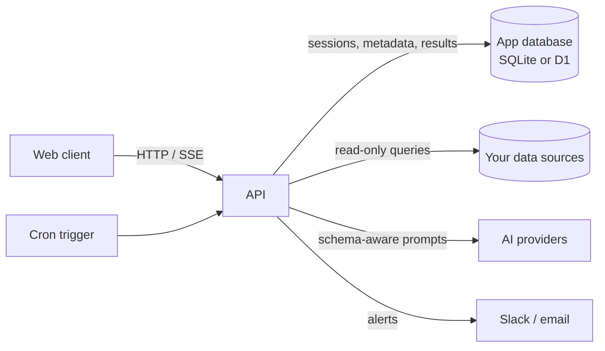

# Heptadec

Query, visualize, and monitor the data systems your team already runs — from one place.

Heptadec connects to relational databases, document stores, key-value caches, and search engines, then gives a team one interface to explore them: a schema browser, an SQL/command runner, AI-assisted queries, dashboards, scheduled jobs, threshold alerts, share links, and a read-only MCP endpoint for external agents.



## Supported sources

| Engine | Speaks |
|---|---|
| PostgreSQL, MySQL, MariaDB | SQL |
| ClickHouse | SQL |
| SQLite, LibSQL / Turso | SQL |
| MongoDB | Aggregation pipelines |
| Redis | Commands |
| Quickwit | Search queries |

AI providers are configured in the app, not in the environment: Groq, OpenAI, Anthropic, Google, DeepSeek, Ollama, or any OpenAI-compatible endpoint.

## Stack

| Part | Choice |
|---|---|
| API | TypeScript, Hono, Drizzle ORM; runs on Node.js or Cloudflare Workers |
| Web | React, Vite, Tailwind |
| App database | SQLite locally and in Docker; D1 on Workers |
| Images | Cloudflare R2 (signed browser uploads) |
| Background work | In-process scheduler on Node; Cron Trigger + `waitUntil` on Workers |
| Tests | Vitest integration suites against the real app and real databases |

The workspace is `apps/api`, `apps/web`, and `packages/db`. The API owns the wire contract and hands it to the web app typed.

## Quick start

Requirements: Node.js 22 or newer, pnpm 12, and optionally Docker for the demo databases.

```bash
git clone https://github.com/Mbazu-Daniel/Heptadec.git
cd Heptadec
pnpm install
cp .env.example .env
```

Generate the two secrets and put them in `.env`:

```bash
openssl rand -base64 32   # BETTER_AUTH_SECRET
openssl rand -base64 32   # HEPTADEC_SECRET_KEY — keep this one; it encrypts stored credentials
```

Then create the app database and start both servers:

```bash
pnpm db:migrate
pnpm dev
```

The API listens on `http://localhost:8787` and the web app on `http://localhost:5173`.

To try the query features against seeded data, start the demo engines:

```bash
pnpm compose:up    # Postgres, MySQL, Redis
pnpm compose:down  # when finished
```

### Commands

| Purpose | Command |
|---|---|
| Dev servers | `pnpm dev` |
| Typecheck everything | `pnpm typecheck` |
| Integration tests | `pnpm test` |
| Billing tests | `pnpm test:billing` |
| Start the full test stack | `pnpm compose:test:up` |
| Seed the test stack | `pnpm seed:test` |
| Generate / apply app migrations | `pnpm db:generate` / `pnpm db:migrate` |
| Apply migrations to D1 | `pnpm db:migrate:d1` |
| Deploy the Worker | `pnpm deploy` or `pnpm deploy:cloudflare` |

## Configuration

Only two values are required to boot; everything else turns on an integration.

| Variable | Purpose |
|---|---|
| `BETTER_AUTH_SECRET` | Signs session cookies. `openssl rand -base64 32`. |
| `HEPTADEC_SECRET_KEY` | 32-byte base64 key (AES-GCM) for stored data-source and AI credentials. Rotating it makes every stored credential unreadable. |
| `BETTER_AUTH_URL` | Public API address, e.g. `http://localhost:8787`. On Workers it falls back to `PUBLIC_URL`. |
| `WEB_URL` | Public web address, e.g. `http://localhost:5173`. On Workers it falls back to `PUBLIC_URL`. |
| `DATABASE_URL` | App database. `file:./dev.db` locally, `file:./data/heptadec.db` in Docker. |
| `PUBLIC_URL` | The address users open; on Workers this is the value that matters. |

Optional integrations:

- **Google / GitHub sign-in** — `GOOGLE_CLIENT_ID`, `GOOGLE_CLIENT_SECRET`, `GITHUB_CLIENT_ID`, `GITHUB_CLIENT_SECRET`.
- **Email** — Resend (`RESEND_API_KEY`, `RESEND_FROM`) or Cloudflare Email Sending (`CLOUDFLARE_ACCOUNT_ID`, `CLOUDFLARE_EMAIL_TOKEN`, `CLOUDFLARE_EMAIL_FROM`). Without a transport, alerts record `skipped` and nothing breaks.
- **Images** — `R2_ACCESS_KEY_ID`, `R2_SECRET_ACCESS_KEY` (and optionally `R2_SESSION_TOKEN`) sign browser uploads. On Workers the bucket name lives in `wrangler.jsonc`; `R2_PUBLIC_ID` / `R2_CUSTOM_DOMAIN` control the public image URL.
- **Billing** — see below.

### Billing (optional)

Payments run through [Bachs](https://bachs.io). With none of these set, the instance is free and self-hosted. With the key, the webhook secret, and both prices set, every organization must be inside its seven-day trial or a paid period, or the product endpoints answer `402 payment_required`.

| Variable | Purpose |
|---|---|
| `BACHS_SECRET_KEY` | API key, `sk_live_…` |
| `BACHS_WEBHOOK_SECRET` | Signing secret of the webhook endpoint, `whsec_…` |
| `BACHS_PRICE_MONTHLY` | USD for 30 days |
| `BACHS_PRICE_YEARLY` | USD for 365 days |
| `BACHS_BASE_URL` | `https://api.bachs.io` live, `https://sandbox-api.bachs.io` sandbox |

Point a webhook at `https://your-host/api/webhooks/bachs` and subscribe it to `checkout.completed`, `collection.succeeded`, `collection.failed`, and `payment_method.saved`.

## Deploy to Cloudflare Workers

One Worker serves the built SPA and the API from the same origin, so the browser keeps calling `/api/...` relatively and there is no second deployment.

| Concern | How it runs |
|---|---|
| App database | D1 through the `DB` binding; the same Drizzle migrations apply |
| Scheduler | A Cron Trigger calls the same job runner the Node timer calls |
| Password hashing | PBKDF2-SHA256 over WebCrypto — no native module |
| SQLite sources | `@libsql/client`, so local files on Node and `libsql://` URLs on Workers |
| Postgres / MySQL / Redis | TCP through `cloudflare:sockets`; use Hyperdrive for production databases |
| Static assets | Workers static assets with an SPA fallback |
| Compression | Done at the edge; the Worker does not compress twice |

`wrangler.jsonc` is committed and names the resources only — `heptadec` for D1, `heptadec-images` for R2 — so a fork does not deploy into another account. Rename them there before connecting an account that already uses those names.

### One command from a laptop

```bash
pnpm install
pnpm exec wrangler login
```

Put these in `.env`:

```bash
CLOUDFLARE_ACCOUNT_ID=...
PUBLIC_URL=https://heptadec.example.com
BETTER_AUTH_SECRET=...      # generated and saved back if empty
HEPTADEC_SECRET_KEY=...     # generated and saved back if empty
```

Then:

```bash
pnpm deploy:cloudflare
```

The script is idempotent: it checks the login, creates the D1 database and R2 bucket when missing, enables the bucket's public URL, sets the bucket's CORS rule for `PUBLIC_URL`, applies migrations, builds the SPA, deploys the Worker, and sets any missing secrets. Plain variables are written on the first deploy only — after that the dashboard owns them. `BETTER_AUTH_SECRET` and `HEPTADEC_SECRET_KEY` are never rotated automatically.

### Continuous deployment from GitHub

Cloudflare Workers Builds deploys the Worker on every push to `main`. CI itself holds no Cloudflare credentials.

1. Create the resources once:

   ```bash
   pnpm exec wrangler d1 create heptadec
   pnpm exec wrangler r2 bucket create heptadec-images
   ```

2. In the dashboard: **Workers & Pages → Create application → Workers → Connect to Git**. Pick the repository, keep the root directory at the repo root, and name the Worker `heptadec`. Set both commands: build `pnpm run build`, deploy `pnpm run deploy`.

3. Give the build token **D1: Edit** at **My Profile → API Tokens**. The deploy command applies migrations before it deploys, and Workers Builds' default token cannot reach D1.

4. Fill **Settings → Variables and Secrets**:

   | Name | Kind | Notes |
   |---|---|---|
   | `PUBLIC_URL` | variable | The address users open. `BETTER_AUTH_URL` and `WEB_URL` fall back to it. |
   | `BETTER_AUTH_SECRET` | secret | `openssl rand -base64 32` |
   | `HEPTADEC_SECRET_KEY` | secret | `openssl rand -base64 32`; never rotate |
   | `R2_ACCESS_KEY_ID`, `R2_SECRET_ACCESS_KEY` | secret | Required for browser image uploads |
   | `RESEND_API_KEY` | secret | If using Resend for alerts |
   | `RESEND_FROM` | variable | If using Resend |
   | `BACHS_*` | secret / variable | Only when billing is on |

   `R2_BUCKET_NAME` is not on this list: it is a `var` in `wrangler.jsonc` beside the `IMAGES` binding, so the bucket the API signs uploads for is the one it reads back.

5. Allow browser uploads from `PUBLIC_URL`. A new bucket has no CORS rule and refuses the direct `PUT`:

   ```bash
   cat >/tmp/cors.json <<'JSON'
   { "rules": [ { "allowed": { "origins": ["https://heptadec.example.com"], "methods": ["GET", "HEAD", "PUT"], "headers": ["content-type"] }, "exposeHeaders": ["etag"], "maxAgeSeconds": 3600 } ] }
   JSON
   pnpm exec wrangler r2 bucket cors set heptadec-images --file /tmp/cors.json --force
   ```

### Manual deploy

`pnpm run deploy` is the same sequence Workers Builds runs:

```bash
pnpm run build          # apps/web/dist
pnpm run db:migrate:d1  # wrangler d1 migrations apply DB --remote
pnpm run deploy:worker  # wrangler deploy
```

The migration command targets the `DB` binding, not the database name, so a renamed database still migrates the right one.

### Local Worker

```bash
cp .dev.vars.example .dev.vars   # fill the two secrets
pnpm exec wrangler d1 migrations apply DB --local
pnpm exec wrangler dev
```

That runs `worker.ts` in workerd with a local D1 database and the real static assets.

### What does not run on Workers

- **SMTP alert channels** — Workers cannot open port 25; use Resend or Cloudflare Email Sending.
- **Local-file SQLite sources** — there is no filesystem; point the source at a `libsql://` URL.

Both fail as a delivery or connection error, never as a silent skip.

## Deploy with Docker

`docker-compose.app.yml` runs two containers: `api`, and `web` (nginx) serving the built client and proxying `/api`, `/health`, and `/mcp` to the API. The API applies pending migrations on start.

```bash
cp .env.example .env
```

Fill in:

```bash
BETTER_AUTH_SECRET=...          # openssl rand -base64 32
HEPTADEC_SECRET_KEY=...         # openssl rand -base64 32
PUBLIC_URL=https://example.com
DATABASE_URL=file:./data/heptadec.db
```

`./data` is the `heptadec-appdata` volume. Then:

```bash
docker compose -f docker-compose.app.yml up -d --build
```

The web container listens on `${WEB_PORT:-8080}`. Put Caddy, nginx, or a load balancer in front for TLS and pass the real hostname through. `pnpm app:up` and `pnpm app:down` wrap the same file.

Back up everything in one command:

```bash
docker run --rm -v heptadec-app_heptadec-appdata:/data -v "$PWD":/out alpine \
  tar czf /out/heptadec-$(date +%F).db.tar.gz -C /data .
```

Prebuilt `api` and `web` images are published to `ghcr.io/<owner>/<repo>` on pushes to `main`; swap the `build:` blocks in the Compose file for `image:` lines to use them.

## Tests

Tests run through the real app (`buildApp()`), real Better Auth, a real SQLite file, and real engines. They migrate their own `test.db`, so `pnpm test` works from a clean checkout.

```bash
pnpm compose:test:up   # Postgres, MySQL, MariaDB, Redis, ClickHouse, libSQL, MongoDB, Quickwit
pnpm seed:test
pnpm test
pnpm test:billing
pnpm compose:test:down
```

The suite refuses to run against `dev.db`. To point it at another app database, set `DATABASE_URL` explicitly.

## CI

`.github/workflows/ci.yml` runs on pull requests and on pushes to `main`:

| Event | What runs |
|---|---|
| Pull request | Typecheck, web build, the integration suite against the test stack |
| Push to `main` | The same checks, then `api` and `web` images are pushed to `ghcr.io` |

Workers Builds picks up the same `main` commit and deploys the Worker separately.

## Contributing

Fork the repository, branch from `main` as `<type>/<short-description>`, keep Conventional Commit messages with a scope, and open a pull request. Run `pnpm typecheck` and `pnpm test` before pushing.

## Author

Daniel Mbazu — [LinkedIn](https://linkedin.com/in/mbazudaniel) · [X](https://x.com/Mr_MicDaniel)
