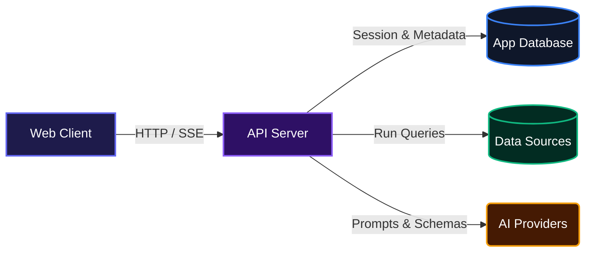
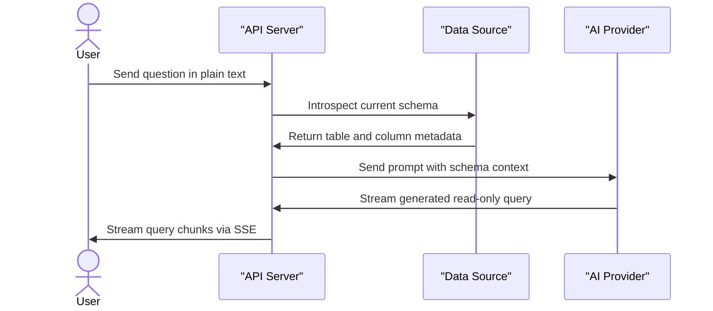
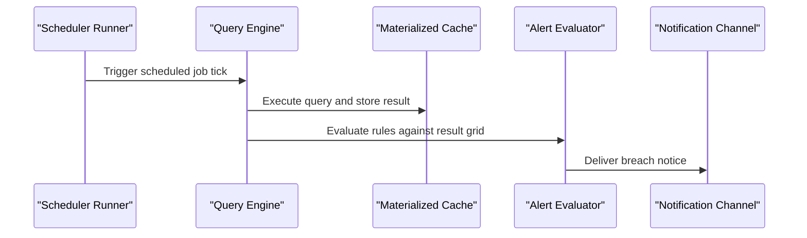

# Heptadec

Unified data visualization, exploration, and monitoring platform for modern engineering teams.

## Overview

Heptadec helps engineering and analytics teams explore, query, and monitor fragmented data systems from a single interface. Instead of juggling isolated client tools for relational tables, document stores, key-value caches, and search clusters, teams can connect all their databases, build visual dashboards, configure automated alerts, and generate queries using natural language.

## System Architecture



## Features

- **Multi-Engine Database Querying**: Connect directly to Postgres, MySQL, MariaDB, ClickHouse, SQLite, LibSQL, MongoDB, Redis, and Quickwit. Run raw SQL, MongoDB aggregation pipelines, Redis commands, or Quickwit search queries through a unified runner.
- **Introspection and Schema Mapping**: Automatically inspect database structures, primary keys, foreign keys, and indexes to construct interactive relationship diagrams across supported engines.
- **Natural Language Query Generation**: Translate plain English questions into read-only SQL, Mongo pipelines, or Redis commands using contextual schema pruning and configurable LLM providers (Groq, OpenAI, Anthropic, Google, DeepSeek, Ollama, and custom OpenAI-compatible endpoints).
- **Automated Dashboards and AI Iteration**: Generate multi-chart visualization dashboards from connected data sources. Prompt the system to update, add, or remove charts dynamically.
- **Model Context Protocol (MCP) Server**: Expose safe, read-only data access and schema introspection tools to external AI agents via authenticated MCP endpoints.
- **Scheduled Jobs and Cache Materialization**: Run analytical queries on custom cron schedules across any IANA timezone, materializing query results for fast dashboard loading.
- **Threshold Alerting and Multi-Channel Notifications**: Evaluate threshold rules on scheduled query results and deliver breach notifications to Slack webhooks, direct SMTP email, or Resend.
- **Role-Based Access Control and Workspaces**: Manage multi-tenant organizations with distinct roles (owner, editor, viewer), password resets, team invitations, and full audit logging.
- **Shareable Dashboard Links**: Create read-only, token-protected public links with configurable expiration and rate limiting.

### AI Natural Language Query Generation



### Scheduled Queries and Threshold Alerting



## Technologies Used

| Category | Technology | Description |
|---|---|---|
| Monorepo & Runtime | Node.js | Server runtime (v22+) |
| Package Manager | pnpm | Fast, disk-efficient workspace package management |
| Web Framework | Hono | Fast, lightweight web framework running on Node.js and Cloudflare Workers |
| Database ORM | Drizzle ORM | TypeScript ORM for SQLite, PostgreSQL, and Cloudflare D1 |
| Authentication | Better Auth | Session management, credential auth, and organization plugins |
| Database Drivers | pg, mysql2, redis, mongodb, @clickhouse/client-web, @libsql/client | Multi-engine database connection drivers |
| AI Integration | AI SDK (@ai-sdk/openai-compatible) | Unified LLM streaming and completion interfaces |
| Integrations | Model Context Protocol SDK | Standardized interface for external AI assistants |
| Email & Dispatch | Resend, Nodemailer | Transactional email delivery and alert dispatches |
| Testing | Vitest | Fast TypeScript test runner |
| Deployment | Cloudflare Workers, Docker | Hybrid deployment targets (Node.js containers or Cloudflare Edge) |

## Installation

### Prerequisites

- Node.js (version 22 or higher)
- pnpm (version 9 or higher)
- Docker and Docker Compose (optional, for local demo databases)

### Setup Steps

1. Clone the repository:
```bash
git clone git@github.com:Mbazu-Daniel/Heptadec.git
cd Heptadec
```

2. Install dependencies:
```bash
pnpm install
```

3. Configure environment variables:
```bash
cp .env.example .env
```
Ensure you generate a secure key for `BETTER_AUTH_SECRET` and `HEPTADEC_SECRET_KEY` (a 32-byte base64 string used for AES-GCM data source credential encryption).

4. Apply database migrations to set up the local application SQLite database:
```bash
pnpm db:migrate
```

5. (Optional) Start the local demo databases (Postgres, MySQL, Redis):
```bash
pnpm compose:up
```

6. Start development servers across the monorepo:
```bash
pnpm dev
```
The API listens on `http://localhost:8787` and the client runs on `http://localhost:5173`.

### Operating System Level Environment Variables

If you need to set environment variables or provider API keys directly on your host machine:

- **Windows (PowerShell)**:
```powershell
setx HEPTADEC_SECRET_KEY "your_32_byte_base64_secret_key"
```

- **macOS / Linux (including Termux)**:
```bash
echo 'export HEPTADEC_SECRET_KEY="your_32_byte_base64_secret_key"' >> ~/.bashrc
source ~/.bashrc
```

## Usage

### Connecting a Data Source

You can register any supported data source using the API or the UI by specifying the engine type and connection parameters:

```bash
curl -X POST http://localhost:8787/api/data-sources \
  -H "Content-Type: application/json" \
  -H "Cookie: better-auth.session_token=<YOUR_TOKEN>" \
  -d '{
    "kind": "postgres",
    "name": "Production Warehouse",
    "host": "localhost",
    "port": 5432,
    "database": "heptadec_demo",
    "username": "postgres",
    "password": "Delta1force",
    "readOnly": true
  }'
```

### Running Queries

Execute queries against any connection. The system resolves the correct driver and returns a normalized result grid:

```bash
curl -X POST http://localhost:8787/api/data-sources/<DATA_SOURCE_ID>/query \
  -H "Content-Type: application/json" \
  -H "Cookie: better-auth.session_token=<YOUR_TOKEN>" \
  -d '{
    "sql": "SELECT id, code, name FROM regions ORDER BY id LIMIT 5"
  }'
```

### Asking the AI Assistant

Stream query generation by providing a plain text prompt:

```bash
curl -N -X POST http://localhost:8787/api/ai/ask \
  -H "Content-Type: application/json" \
  -H "Cookie: better-auth.session_token=<YOUR_TOKEN>" \
  -d '{
    "question": "What are the top 5 products by price that are currently in stock?",
    "dataSourceIds": ["<DATA_SOURCE_ID>"]
  }'
```

## Deployment

Two paths: Docker on any VPS, or a single Cloudflare Worker. Both apply the same Drizzle migrations.

### Docker

`docker-compose.app.yml` runs two containers: `api`, and `web` (nginx) serving the built client and proxying `/api`, `/health`, and `/mcp` to the API. The API applies pending migrations on start.

```bash
cp .env.example .env
docker compose -f docker-compose.app.yml up -d --build
```

Four values matter:

| Variable | How to make it |
|---|---|
| `BETTER_AUTH_SECRET` | `openssl rand -base64 32` |
| `HEPTADEC_SECRET_KEY` | `openssl rand -base64 32` |
| `PUBLIC_URL` | The address users open; Compose passes it to the API as `BETTER_AUTH_URL` and `WEB_URL` |
| `DATABASE_URL` | `file:./data/heptadec.db`, inside the `heptadec-appdata` volume |

The web container listens on `${WEB_PORT:-8080}`. Put Caddy, nginx, or a load balancer in front for TLS and pass the real hostname through. `pnpm app:up` and `pnpm app:down` wrap the same Compose file. Images for both targets are published to `ghcr.io/<owner>/<repo>/api` and `/web` on pushes to `main`; swap the `build:` blocks for `image:` lines to deploy those instead.

Back up the database, which lives entirely in that volume:

```bash
docker run --rm -v heptadec-app_heptadec-appdata:/data -v "$PWD":/out alpine \
  tar czf /out/heptadec-$(date +%F).db.tar.gz -C /data .
```

### Cloudflare Workers

One Worker serves the SPA and the API from the same origin, so the client keeps calling `/api/...` relatively. The origin comes from `PUBLIC_URL`, which names the address users open.

Provisioning and deploy are one idempotent command:

```bash
pnpm --filter @heptadec/api exec wrangler login
pnpm deploy:cloudflare
```

The script creates the D1 database when it is missing and records its id in `.env`, creates the R2 image bucket, allows browser uploads from the app's origin, sets `BETTER_AUTH_SECRET` and `HEPTADEC_SECRET_KEY` when they are absent, applies migrations, and deploys the Worker. Re-running it leaves what already exists alone.

#### The Worker's configuration

`apps/api/wrangler.jsonc` names this project's Cloudflare resources, so it is **not** committed: the repository is public, and a fork should not carry another account's database id. `apps/api/wrangler.jsonc.example` is the shape, and `pnpm config:worker` writes the real file from the environment:

```bash
pnpm config:worker
```

The values come from the environment — the gitignored `.env` on a laptop, repository secrets in CI:

| Value | What it names |
|---|---|
| `CLOUDFLARE_ACCOUNT_ID` | The account to deploy into |
| `CLOUDFLARE_D1_DATABASE_ID` | The D1 database the Worker reads |
| `R2_BUCKET_NAME` | The bucket holding logos and avatars |
| `R2_PUBLIC_ID` | The bucket's managed `r2.dev` domain |
| `PUBLIC_URL` | The address users open; it becomes the Worker's `BETTER_AUTH_URL` and `WEB_URL` |
| `RESEND_FROM` | The sender address |

`pnpm db:migrate:d1` and `pnpm deploy:worker` write the configuration first, so neither needs it to exist.

#### From GitHub Actions

CI deploys the Worker, and Cloudflare's own git integration is switched off so there is one path that deploys it. The `Worker` job runs on a push to `main` and does two things in order:

```bash
pnpm db:migrate:d1     # the schema lands first
pnpm deploy:worker     # then the Worker that reads it
```

`wrangler.jsonc` lives in `apps/api`, so `npx wrangler deploy` at the repository root fails with "the Cloudflare application detection logic has been run in the root of a workspace". The two root scripts run wrangler in the right directory.

The job reads the same values from repository secrets, so the repository holds none of them:

| Secret | What it is |
|---|---|
| `CLOUDFLARE_API_TOKEN` | An API token with Workers write and D1 edit |
| `CLOUDFLARE_ACCOUNT_ID` | The account the Worker belongs to |
| `CLOUDFLARE_D1_DATABASE_ID` | The D1 database the Worker reads |
| `R2_BUCKET_NAME` | The bucket holding logos and avatars |
| `R2_PUBLIC_ID` | The bucket's managed `r2.dev` domain |
| `PUBLIC_URL` | The address users open |
| `RESEND_FROM` | The sender address |

| Concern | How it runs on Workers |
|---|---|
| App database | D1 through `drizzle-orm/d1`, bound per request |
| Scheduler | A Cron Trigger calls the same `runDueJobs` handler as the Node timer |
| SQLite data sources | `@libsql/client`, so point them at `libsql://` URLs |
| Postgres, MySQL, Redis | TCP through `cloudflare:sockets`; put Hyperdrive in front in production |
| Web assets | Workers static assets, with `index.html` as the SPA fallback |

Secrets never live in `wrangler.jsonc`:

```bash
pnpm --filter @heptadec/api exec wrangler secret put BETTER_AUTH_SECRET
pnpm --filter @heptadec/api exec wrangler secret put HEPTADEC_SECRET_KEY
pnpm --filter @heptadec/api exec wrangler secret put R2_ACCESS_KEY_ID
pnpm --filter @heptadec/api exec wrangler secret put R2_SECRET_ACCESS_KEY
pnpm --filter @heptadec/api exec wrangler secret put RESEND_API_KEY
```

`HEPTADEC_SECRET_KEY` encrypts stored data-source credentials, so rotating it makes every stored credential unreadable. `BETTER_AUTH_URL` and `WEB_URL` are plain vars in the rendered configuration; they come from `PUBLIC_URL`. `RESEND_API_KEY` is a secret rather than a var, so it is not readable in the dashboard.

The bucket's CORS rule allows the app's origin to PUT an upload. Without it the browser refuses the upload with "CORS not configured for this bucket", and the failure looks like a broken upload button rather than a missing bucket rule. `pnpm deploy:cloudflare` writes that rule and replaces whatever was there, so a second origin is added after the deploy with `wrangler r2 bucket cors set`.

The manual equivalent, when you would rather drive wrangler yourself:

```bash
pnpm config:worker
pnpm db:migrate:d1
pnpm deploy:worker
```

To develop against workerd with a local D1 database instead of Node:

```bash
pnpm config:worker
pnpm --filter @heptadec/api exec wrangler dev
```

Two things do not run on Workers: SMTP alert channels, because there is no port 25 (use Resend or Cloudflare Email Sending), and local-file SQLite data sources, because there is no filesystem (point them at a `libsql://` URL). Both surface as a delivery or connection error rather than a silent skip.

### Billing (Bachs)

[Bachs](https://bachs.io) holds the products and collects the card details; this app stores only the state its webhooks report. Five values come from Bachs, and **all of them are needed** — with any one missing, billing reports itself unconfigured and the instance stays free.

| Value | Where it goes | What it is |
|---|---|---|
| `BACHS_SECRET_KEY` | Worker secret | The API key from Bachs → Developers → API keys, `sk_live_…` |
| `BACHS_WEBHOOK_SECRET` | Worker secret | The signing secret of the webhook endpoint, `whsec_…` |
| `BACHS_PRODUCT_MONTHLY` | Worker var | The product billed monthly, `prod_…` |
| `BACHS_PRODUCT_YEARLY` | Worker var | The product billed yearly, `prod_…` |
| `BACHS_BASE_URL` | Worker var | `https://api.bachs.io` for live, `https://sandbox-api.bachs.io` for the sandbox |

The two secrets are set on the Worker:

```bash
pnpm --filter @heptadec/api exec wrangler secret put BACHS_SECRET_KEY
pnpm --filter @heptadec/api exec wrangler secret put BACHS_WEBHOOK_SECRET
```

The three vars are read from the environment, like the rest of the Worker's configuration: in `.env` on a laptop, as the `BACHS_BASE_URL`, `BACHS_PRODUCT_MONTHLY` and `BACHS_PRODUCT_YEARLY` repository secrets in CI.

**Two products, because a product's cycle cannot be changed afterwards.** Create one per cycle, give each a price, and keep them in step with the amounts the app advertises — $5.00 monthly and $50.00 yearly, in `apps/api/src/modules/billing/catalog.ts`. Bachs charges what its own catalogue says.

**The webhook endpoint** is `https://your-host/api/webhooks/bachs`, and it must be subscribed to the three subscription events:

- `customer.subscription.created`
- `customer.subscription.updated`
- `customer.subscription.deleted`

The delivery carries the organization in `data.metadata.organization_id`, and the app verifies it with the `x-bachs-signature-v2` header against the webhook secret.

**A sandbox key against the live host is refused** rather than charged, so the base URL and the key have to be changed together.

**Turning this on has a consequence.** The trial belongs to this app, not to Bachs: **seven days from the moment the organization was created**, with no card taken at sign-up. An organization older than that has already spent its trial, so enabling billing locks out every organization that is not already subscribed — they meet `402 payment_required` on the product's endpoints. On a fresh database there is nobody to lock out yet.

## Continuous integration

`.github/workflows/ci.yml` runs on every pull request and on every push to `dev` and `main`. What it does depends on the branch:

| Event | Job | What runs |
|---|---|---|
| Pull request | `Checks` | Typecheck, web build, the integration suite against the test stack |
| Push to `dev` | `Checks` | The same |
| Push to `main` | `Checks`, then `Images` and `Worker` | The checks first; then the Docker images are pushed to `ghcr.io` and the Worker is migrated and deployed |

`dev` is where work lands: open a pull request against `dev`, and it is checked there. `main` is the release: merging `dev` into `main` is what builds the images and deploys the Worker, so nothing reaches the running deployment without the checks passing first.

The `Worker` job needs two repository secrets, `CLOUDFLARE_API_TOKEN` and `CLOUDFLARE_ACCOUNT_ID`. A pull request never sees them: the workflow triggers on `pull_request`, which gives a fork no access to secrets, and the deploy job runs only on a push to `main`.

The integration suite needs the test stack — Postgres, MySQL, MariaDB, Redis, ClickHouse, libSQL, MongoDB and Quickwit — which CI starts with `pnpm compose:test:up` and fills with `pnpm seed:test`.

## Environment Variables

| Variable | Description | Example |
|---|---|---|
| `API_PORT` | Port for the API server | `8787` |
| `DATABASE_URL` | Local app database connection string | `file:./data/heptadec.db` |
| `BETTER_AUTH_SECRET` | Secret key used for signing session tokens | `random_secret_string` |
| `BETTER_AUTH_URL` | Public base URL of the auth and API server | `http://localhost:8787` |
| `WEB_URL` | Base URL of the web frontend application | `http://localhost:5173` |
| `HEPTADEC_SECRET_KEY` | 32-byte Base64 key for AES-GCM encryption of stored secrets | `BASE64_32_BYTE_STRING` |
| `EMAIL_TRANSPORT` | Active email transport provider (`resend` or `cloudflare`) | `resend` |
| `RESEND_API_KEY` | API key for Resend email delivery | `re_123456789` |
| `RESEND_FROM` | Sender email address for Resend | `Heptadec <alerts@example.com>` |
| `CLOUDFLARE_ACCOUNT_ID` | Cloudflare account ID for R2 and email dispatch | `your_account_id` |
| `CLOUDFLARE_EMAIL_TOKEN` | API token for Cloudflare email sending | `your_cf_email_token` |
| `CLOUDFLARE_EMAIL_FROM` | Sender address for Cloudflare email | `notifications@example.com` |
| `R2_BUCKET_NAME` | Bucket holding logos and avatars | `heptadec-images` |
| `R2_ACCESS_KEY_ID` | R2 access key that signs an upload | `your_r2_access_key_id` |
| `R2_SECRET_ACCESS_KEY` | R2 secret key that signs an upload | `your_r2_secret_access_key` |
| `R2_SESSION_TOKEN` | Session token, only for temporary R2 credentials | `your_r2_session_token` |
| `R2_PUBLIC_ID` | Bucket id behind the managed `r2.dev` domain, read from | `your_bucket_id` |
| `R2_CUSTOM_DOMAIN` | Custom domain for the bucket; it wins over the managed one | `images.example.com` |
| `GOOGLE_CLIENT_ID` | Google OAuth Client ID | `your_google_client_id` |
| `GOOGLE_CLIENT_SECRET` | Google OAuth Client Secret | `your_google_client_secret` |
| `GITHUB_CLIENT_ID` | GitHub OAuth App Client ID | `your_github_client_id` |
| `GITHUB_CLIENT_SECRET` | GitHub OAuth App Client Secret | `your_github_client_secret` |

## API Documentation

All routes except public health checks, share links, and public auth callbacks require an authenticated session cookie or appropriate authorization headers.

### System & Health

#### GET /health
**Description**: Returns service health status.

**Request**:
None

**Response**:
```json
{
  "ok": true
}
```

**Errors**:
- 500: Server unavailable

---

### Authentication & Profiles

#### GET /api/providers
**Description**: Lists enabled social authentication providers.

**Request**:
None

**Response**:
```json
{
  "providers": [
    {
      "id": "github",
      "label": "Sign in with GitHub"
    }
  ]
}
```

**Errors**:
- 500: Failed to load auth providers

#### GET /api/me
**Description**: Retrieves current user profile, membership details, and active organization.

**Request**:
None

**Response**:
```json
{
  "user": {
    "id": "usr_123",
    "name": "Jane Doe",
    "email": "jane@example.com",
    "image": null,
    "hasPassword": true,
    "onboardingCompleted": true
  },
  "displayName": "Jane",
  "image": null
}
```

**Errors**:
- 401: Authentication required

#### POST /api/onboarding/complete
**Description**: Marks user onboarding as completed.

**Request**:
None

**Response**:
```json
{
  "user": {
    "id": "usr_123",
    "onboardingCompleted": true
  }
}
```

**Errors**:
- 401: Authentication required

---

### Organizations & Members

#### GET /api/organization
**Description**: Lists all organizations the authenticated user belongs to.

**Request**:
None

**Response**:
```json
{
  "organizations": [
    {
      "organization": {
        "id": "org_abc",
        "name": "Acme Analytics",
        "slug": "acme-analytics",
        "logo": null,
        "logoUrl": null
      },
      "role": "owner",
      "active": true
    }
  ],
  "activeOrganizationId": "org_abc"
}
```

**Errors**:
- 401: Authentication required

#### POST /api/organization/switch
**Description**: Switches the user active organization context.

**Request**:
```json
{
  "organizationId": "org_xyz"
}
```

**Response**:
```json
{
  "activeOrganizationId": "org_xyz"
}
```

**Errors**:
- 400: An organization id is required
- 401: Authentication required
- 403: You are not a member of that organization

#### POST /api/organization/delete
**Description**: Permanently deletes the active organization and all related scoped data.

**Request**:
```json
{
  "slug": "acme-analytics"
}
```

**Response**:
```json
{
  "deleted": true
}
```

**Errors**:
- 400: That slug is not this organization's
- 401: Authentication required
- 403: Only an owner can delete an organization

#### GET /api/organization/members
**Description**: Lists all members of the active organization.

**Request**:
None

**Response**:
```json
{
  "members": [
    {
      "id": "mem_1",
      "userId": "usr_123",
      "name": "Jane Doe",
      "email": "jane@example.com",
      "displayName": "Jane",
      "image": null,
      "role": "owner",
      "isYou": true
    }
  ]
}
```

**Errors**:
- 401: Authentication required
- 403: You are not a member of that organization

#### PATCH /api/organization/members/:id
**Description**: Updates a member role within the organization.

**Request**:
```json
{
  "role": "editor"
}
```

**Response**:
```json
{
  "id": "mem_2",
  "role": "editor"
}
```

**Errors**:
- 400: That role does not exist
- 401: Authentication required
- 403: Only an owner can change a role

#### DELETE /api/organization/members/:id
**Description**: Removes a member from the organization.

**Request**:
None

**Response**:
```json
{
  "removed": "mem_2"
}
```

**Errors**:
- 401: Authentication required
- 403: Only an owner can remove a member

---

### Invitations

#### GET /api/organization/invitations
**Description**: Lists all pending invitations for the current organization.

**Request**:
None

**Response**:
```json
{
  "invitations": [
    {
      "id": "inv_123",
      "email": "teammate@example.com",
      "role": "editor",
      "status": "pending",
      "expiresAt": "2026-04-01T00:00:00.000Z"
    }
  ]
}
```

**Errors**:
- 401: Authentication required
- 403: Only an owner can see invitations

#### POST /api/organization/invitations
**Description**: Sends an email invitation to join the organization.

**Request**:
```json
{
  "email": "teammate@example.com",
  "role": "editor"
}
```

**Response**:
```json
{
  "invited": "teammate@example.com",
  "role": "editor",
  "organizationId": "org_abc"
}
```

**Errors**:
- 400: The email address is not valid
- 401: Authentication required
- 403: Only an owner can invite members

#### GET /api/invitation/:id
**Description**: Previews invitation details before accepting.

**Request**:
None

**Response**:
```json
{
  "id": "inv_123",
  "organizationName": "Acme Analytics",
  "organizationSlug": "acme-analytics",
  "email": "teammate@example.com",
  "role": "editor",
  "status": "pending",
  "expiresAt": "2026-04-01T00:00:00.000Z"
}
```

**Errors**:
- 404: That invitation does not exist or is no longer valid

#### POST /api/invitation/:id/accept
**Description**: Accepts a pending organization invitation.

**Request**:
None

**Response**:
```json
{
  "organizationId": "org_abc",
  "organizationName": "Acme Analytics",
  "role": "editor"
}
```

**Errors**:
- 401: Authentication required
- 404: That invitation does not exist

---

### Data Sources

#### GET /api/data-sources
**Description**: Lists all configured data sources in the active organization.

**Request**:
None

**Response**:
```json
{
  "dataSources": [
    {
      "id": "ds_123",
      "organizationId": "org_abc",
      "kind": "postgres",
      "name": "Main Warehouse",
      "host": "localhost",
      "port": 5432,
      "socketPath": null,
      "connectionMode": "tcp",
      "database": "heptadec_demo",
      "schemaName": "public",
      "options": null,
      "username": "postgres",
      "hasSecret": true,
      "hasCaCert": false,
      "hasClientCert": false,
      "hasClientKey": false,
      "hasToken": false,
      "readOnly": true,
      "sqlDialect": "postgres",
      "queryLanguage": "sql",
      "canExplain": true,
      "tooling": true,
      "createdAt": "2026-01-01T00:00:00.000Z",
      "updatedAt": "2026-01-01T00:00:00.000Z"
    }
  ]
}
```

**Errors**:
- 401: Authentication required

#### POST /api/data-sources
**Description**: Registers a new data source connection.

**Request**:
```json
{
  "kind": "postgres",
  "name": "Main Warehouse",
  "host": "localhost",
  "port": 5432,
  "database": "heptadec_demo",
  "username": "postgres",
  "password": "Delta1force",
  "readOnly": true
}
```

**Response**:
```json
{
  "dataSource": {
    "id": "ds_123",
    "name": "Main Warehouse",
    "kind": "postgres",
    "readOnly": true
  }
}
```

**Errors**:
- 400: Missing or invalid connection parameter
- 401: Authentication required
- 403: Only owners and editors can add data sources

#### PATCH /api/data-sources/:id
**Description**: Updates connection parameters for an existing data source.

**Request**:
```json
{
  "name": "Primary PostgreSQL Warehouse",
  "readOnly": true
}
```

**Response**:
```json
{
  "dataSource": {
    "id": "ds_123",
    "name": "Primary PostgreSQL Warehouse"
  }
}
```

**Errors**:
- 400: Invalid payload
- 401: Authentication required
- 404: That data source does not exist

#### DELETE /api/data-sources/:id
**Description**: Deletes a data source connection.

**Request**:
None

**Response**:
```json
{
  "removed": "ds_123"
}
```

**Errors**:
- 401: Authentication required
- 404: That data source does not exist

#### POST /api/data-sources/test
**Description**: Verifies database connectivity without persisting credentials.

**Request**:
```json
{
  "kind": "postgres",
  "name": "Test Connection",
  "host": "localhost",
  "port": 5432,
  "database": "heptadec_demo",
  "username": "postgres",
  "password": "Delta1force"
}
```

**Response**:
```json
{
  "ok": true,
  "total": 8,
  "sample": ["regions", "categories", "suppliers", "products"]
}
```

**Errors**:
- 400: Connection payload invalid
- 502: The database could not be reached

#### GET /api/data-sources/:id/objects
**Description**: Lists queryable entities (tables, collections, or indexes) within a data source.

**Request**:
None

**Response**:
```json
{
  "objects": [
    { "name": "public.products", "type": "table" },
    { "name": "public.orders", "type": "table" }
  ]
}
```

**Errors**:
- 401: Authentication required
- 404: That data source does not exist
- 502: The database could not be reached

#### POST /api/data-sources/:id/preview
**Description**: Previews initial records of a specific entity.

**Request**:
```json
{
  "object": "public.products",
  "limit": 2
}
```

**Response**:
```json
{
  "columns": ["id", "name", "price", "in_stock"],
  "rows": [
    { "id": 1, "name": "Meridian 14", "price": "1299.00", "in_stock": true },
    { "id": 2, "name": "Meridian 16", "price": "1899.00", "in_stock": true }
  ],
  "truncated": false
}
```

**Errors**:
- 400: Object or limit invalid
- 404: That object does not exist

---

### Query Execution & Schemas

#### POST /api/data-sources/:id/query
**Description**: Executes an engine-specific statement (SQL, Mongo pipeline, Redis command, or Quickwit search).

**Request (SQL)**:
```json
{
  "sql": "SELECT name, price FROM products WHERE in_stock = true LIMIT 5"
}
```

**Response**:
```json
{
  "columns": ["name", "price"],
  "columnTypes": ["varchar", "numeric"],
  "rows": [
    { "name": "Meridian 14", "price": "1299.00" },
    { "name": "Meridian 16", "price": "1899.00" }
  ],
  "rowCount": 2,
  "truncated": false,
  "durationMs": 14
}
```

**Errors**:
- 400: Query rejected (syntax error or write attempted on read-only source)
- 401: Authentication required
- 404: That data source does not exist

#### POST /api/data-sources/:id/explain
**Description**: Generates an execution plan for a SQL query on supported engines.

**Request**:
```json
{
  "sql": "SELECT * FROM orders WHERE total > 1000"
}
```

**Response**:
```json
{
  "plan": {
    "nodeType": "Seq Scan",
    "relationName": "orders",
    "startupCost": 0.0,
    "totalCost": 1.04,
    "planRows": 2,
    "planWidth": 52,
    "children": []
  }
}
```

**Errors**:
- 400: Statement could not be explained
- 404: That data source does not exist

#### GET /api/data-sources/:id/schema
**Description**: Introspects full schema, returning tables, typed columns, and foreign key relationships.

**Request**:
None

**Response**:
```json
{
  "sourceId": "ds_123",
  "database": "heptadec_demo",
  "schemaName": "public",
  "tables": [
    {
      "name": "products",
      "columns": [
        { "name": "id", "dataType": "integer", "nullable": false, "primaryKey": true },
        { "name": "name", "dataType": "character varying", "nullable": false, "primaryKey": false }
      ],
      "indexedColumns": ["category_id"]
    }
  ],
  "relationships": [
    {
      "id": "products_category_id_fkey:1",
      "constraint": "products_category_id_fkey",
      "fromTable": "products",
      "fromColumn": "category_id",
      "toTable": "categories",
      "toColumn": "id"
    }
  ],
  "introspectedAt": "2026-03-31T12:00:00.000Z"
}
```

**Errors**:
- 401: Authentication required
- 404: That data source does not exist

---

### Dashboards & Widgets

#### GET /api/dashboards
**Description**: Lists all dashboards in the organization.

**Request**:
None

**Response**:
```json
{
  "dashboards": [
    {
      "id": "dash_123",
      "name": "Executive Overview",
      "createdAt": "2026-01-01T00:00:00.000Z",
      "updatedAt": "2026-01-01T00:00:00.000Z"
    }
  ]
}
```

**Errors**:
- 401: Authentication required

#### POST /api/dashboards
**Description**: Creates a new dashboard bound to one or more data sources.

**Request**:
```json
{
  "name": "Sales Metrics",
  "dataSourceIds": ["ds_123"]
}
```

**Response**:
```json
{
  "dashboard": {
    "id": "dash_123",
    "name": "Sales Metrics",
    "widgets": [],
    "sources": [
      {
        "dataSourceId": "ds_123",
        "name": "Main Warehouse",
        "kind": "postgres",
        "tooling": true
      }
    ]
  }
}
```

**Errors**:
- 400: Connect at least one data source
- 401: Authentication required
- 403: Only owners and editors can create dashboards

#### GET /api/dashboards/:id
**Description**: Fetches dashboard details, connected sources, and configured widgets.

**Request**:
None

**Response**:
```json
{
  "dashboard": {
    "id": "dash_123",
    "name": "Sales Metrics",
    "widgets": [],
    "sources": []
  }
}
```

**Errors**:
- 401: Authentication required
- 404: That dashboard does not exist

#### POST /api/dashboards/:id/widgets
**Description**: Adds a chart widget to an existing dashboard based on a saved query.

**Request**:
```json
{
  "savedQueryId": "sq_456",
  "chartType": "bar",
  "title": "Revenue by Region",
  "labelColumn": "region_name",
  "valueColumn": "total_revenue"
}
```

**Response**:
```json
{
  "widget": {
    "id": "wid_789",
    "dashboardId": "dash_123",
    "savedQueryId": "sq_456",
    "chartType": "bar",
    "title": "Revenue by Region",
    "labelColumn": "region_name",
    "valueColumn": "total_revenue"
  }
}
```

**Errors**:
- 400: Chart parameters or column mapping invalid
- 404: Dashboard or saved query does not exist

#### GET /api/widgets/:id/data
**Description**: Retrieves cached or materialized chart points for a specific widget.

**Request**:
None

**Response**:
```json
{
  "points": [
    { "label": "Europe West", "value": 1299.0 },
    { "label": "US East", "value": 549.5 }
  ],
  "rowCount": 2,
  "truncated": false,
  "durationMs": 8,
  "ranAt": "2026-03-31T12:00:00.000Z",
  "stale": false
}
```

**Errors**:
- 404: That chart does not exist

---

### AI Query Generation & Assistant

#### POST /api/ai/ask
**Description**: Streams query generation for a natural language prompt via Server-Sent Events (SSE).

**Request**:
```json
{
  "question": "Show revenue grouped by supplier region",
  "dataSourceIds": ["ds_123"]
}
```

**Response** (SSE stream):
```
event: status
data: {"message":"Reading the structure…"}

event: delta
data: {"text":"SELECT r.name AS region, SUM(o.total) AS total_revenue "}

event: done
data: {"chatId":"chat_1","language":"sql","answered":true,"durationMs":950}
```

**Errors**:
- 400: Question missing or no AI provider configured
- 401: Authentication required
- 403: Only owners and editors can ask questions

#### POST /api/dashboards/generate
**Description**: Streams AI dashboard generation, creating charts and executing plan queries automatically.

**Request**:
```json
{
  "name": "Inventory Overview",
  "dataSourceIds": ["ds_123"],
  "brief": "Focus on high value products and stock levels"
}
```

**Response** (SSE stream):
```
event: status
data: {"message":"Reading Main Warehouse…"}

event: status
data: {"message":"Added Product Distribution"}

event: done
data: {"dashboard":{"id":"dash_999","name":"Inventory Overview","widgets":[]},"durationMs":3200}
```

**Errors**:
- 400: Missing parameters
- 403: Forbidden

---

### Model Context Protocol (MCP)

#### POST /api/mcp-tokens
**Description**: Creates an API token for external MCP AI assistants with scoped capabilities.

**Request**:
```json
{
  "name": "Claude Desktop Agent",
  "capabilities": ["list_data_sources", "describe_data_source", "run_query"]
}
```

**Response**:
```json
{
  "id": "key_123",
  "name": "Claude Desktop Agent",
  "token": "mcp_sec_abc123456789",
  "enabled": true,
  "capabilities": ["list_data_sources", "describe_data_source", "run_query"]
}
```

**Errors**:
- 400: Capability list invalid
- 403: Only owners can create MCP tokens

#### ALL /mcp
**Description**: Web-standard Streamable HTTP MCP transport endpoint used by AI agents.

**Request**:
MCP JSON-RPC protocol with `Authorization: Bearer <MCP_TOKEN>`.

**Response**:
MCP JSON-RPC response.

**Errors**:
- 401: That MCP token is not valid
- 429: Token rate limit exceeded

---

### Scheduled Jobs & Alerts

#### GET /api/scheduled-jobs
**Description**: Lists all recurring query jobs.

**Request**:
None

**Response**:
```json
{
  "scheduledJobs": [
    {
      "id": "job_123",
      "savedQueryId": "sq_456",
      "savedQueryName": "Hourly Sales Check",
      "name": "Hourly Sales",
      "cron": "0 * * * *",
      "timezone": "UTC",
      "ttlSeconds": 3600,
      "nextRunAt": "2026-03-31T13:00:00.000Z",
      "lastRunAt": "2026-03-31T12:00:00.000Z"
    }
  ]
}
```

**Errors**:
- 401: Authentication required

#### POST /api/scheduled-jobs
**Description**: Schedules a saved query to run on a cron cadence.

**Request**:
```json
{
  "savedQueryId": "sq_456",
  "name": "Hourly Sales Refresh",
  "cron": "0 * * * *",
  "timezone": "UTC",
  "ttlSeconds": 3600
}
```

**Response**:
```json
{
  "scheduledJob": {
    "id": "job_123",
    "name": "Hourly Sales Refresh",
    "nextRunAt": "2026-03-31T13:00:00.000Z"
  }
}
```

**Errors**:
- 400: Invalid cron expression or IANA timezone
- 404: That saved query does not exist

#### POST /api/alert-rules
**Description**: Defines an evaluation rule on a query column to trigger upon scheduled execution.

**Request**:
```json
{
  "savedQueryId": "sq_456",
  "name": "High Volume Alert",
  "column": "total",
  "operator": ">=",
  "threshold": 1000
}
```

**Response**:
```json
{
  "alertRule": {
    "id": "alr_123",
    "savedQueryId": "sq_456",
    "name": "High Volume Alert",
    "column": "total",
    "operator": ">=",
    "threshold": 1000,
    "scheduled": true
  }
}
```

**Errors**:
- 400: Operator must be one of >, >=, <, <=, or =
- 404: That saved query does not exist

#### GET /api/alert-deliveries
**Description**: Returns delivery logs for triggered alert rules.

**Request**:
None

**Response**:
```json
{
  "alertDeliveries": [
    {
      "id": "del_123",
      "alertRuleId": "alr_123",
      "channel": "slack",
      "status": "sent",
      "message": "High Volume Alert: 2 rows do - total >= 1000 in the last run.",
      "error": null,
      "createdAt": "2026-03-31T12:00:05.000Z"
    }
  ]
}
```

**Errors**:
- 401: Authentication required

---

### Notification Channels

#### GET /api/notification-channels
**Description**: Lists notification destinations configured for the organization.

**Request**:
None

**Response**:
```json
{
  "notificationChannels": [
    {
      "id": "nc_123",
      "name": "DevOps Alerts",
      "kind": "slack",
      "recipients": [],
      "config": {
        "channel": "#alerts"
      }
    }
  ]
}
```

**Errors**:
- 401: Authentication required

#### POST /api/notification-channels
**Description**: Connects a new notification destination (Slack, Email, or Resend).

**Request**:
```json
{
  "name": "Engineering Slack",
  "kind": "slack",
  "webhookUrl": "https://hooks.slack.com/services/T00/B00/XXXXX",
  "channel": "#db-alerts"
}
```

**Response**:
```json
{
  "notificationChannel": {
    "id": "nc_123",
    "name": "Engineering Slack",
    "kind": "slack"
  }
}
```

**Errors**:
- 400: Invalid webhook URL or channel parameters
- 403: Only owners can manage notification channels

---

### Audit Logs

#### GET /api/audit-logs
**Description**: Retrieves immutable organization audit records.

**Request**:
Query parameters: `event`, `target`, `since`, `until`, `q`

**Response**:
```json
{
  "auditLogs": [
    {
      "id": "aud_123",
      "occurredAt": "2026-03-31T12:00:00.000Z",
      "actorId": "usr_123",
      "actorLabel": "Jane Doe",
      "event": "data_source.created",
      "targetKind": "data_source",
      "targetId": "ds_123",
      "targetLabel": "Main Warehouse",
      "detail": null
    }
  ]
}
```

**Errors**:
- 401: Authentication required
- 403: Only owners can see the audit log

## Contributing

Contributions are welcome. If you want to contribute, please follow these steps:

1. Fork the repository.
2. Create a branch for your feature or bug fix:
```bash
git checkout -b feature/your-feature-name
```
3. Ensure all tests and type checks pass:
```bash
pnpm typecheck
pnpm test
```
4. Commit your changes and open a pull request against `dev`.

## Author

- **Daniel Mbazu**
- LinkedIn: https://linkedin.com/in/mbazudaniel
- X: https://x.com/Mr_MicDaniel

## Badges

[](https://www.typescriptlang.org/)
[](https://nodejs.org/)
[](https://hono.dev/)
[](https://react.dev/)
[](https://www.postgresql.org/)
[](https://redis.io/)
[](https://www.mongodb.com/)
[](https://www.docker.com/)

[](https://dokugen.samueltuoyo.com)